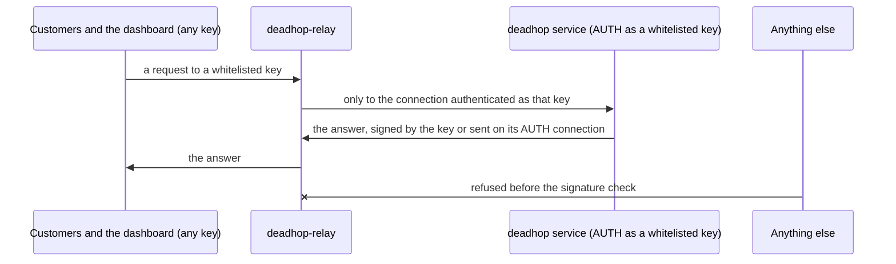

<div align="center">

<picture>
  <source media="(prefers-color-scheme: dark)" srcset="https://deadhop.run/docs/mark-fog.svg">
  
</picture>

# deadhop relay

A Nostr relay that carries one deadhop service's traffic and nothing else.

[](https://github.com/deadhop/relay/actions/workflows/ci.yml)
[](#develop)
[](LICENSE)
[](https://deadhop.run/docs/relay/)

</div>

[deadhop](https://deadhop.run) has no open port: its service and dashboard talk only through
Nostr relays, using [ContextVM](https://contextvm.org) (MCP over Nostr). `deadhop-relay` is a
relay you run for your own service. You give it your service's keys, and it accepts three
things:

- **requests to those keys**, from anyone: ContextVM messages and gift wraps (kinds 25910, 1059
  and 21059);
- **answers from those keys**, signed by them or sent on a connection that proved the key with
  NIP-42 AUTH;
- **those keys' announcements**.

Everything else is refused before any signature is checked.



Run it on your home network to keep admin traffic off public relays, or on a small VPS as the
service's main relay or a fallback. It can also listen on Tor, I2P and FIPS, alone or all at
once ([networks](https://deadhop.run/docs/relay/networks.html)).

| Measure | Result |
| --- | --- |
| Dropped | **0** of 300,000 round trips, none refused, including under floods of up to 970,000 messages a second |
| Throughput | 4,823 round trips a second with 1,000 clients on 2 CPUs and 1 GiB, p99 27.5 ms ([benchmark](https://deadhop.run/docs/relay/performance.html)) |
| Size | one static binary of about 2 MB; about 2.7 MiB of memory idle; no disk |
| Privacy | a request reaches only the connection authenticated as its recipient |

## Quick start

With Rust:

```sh
git clone https://github.com/deadhop/relay && cd relay
cargo build --release
export DEADHOP_RELAY_WHITELIST="invoices=npub1…,admin=npub1…"   # deadhop's server.pubkey and admin.pubkey
./target/release/deadhop-relay check                             # print what it understood; start nothing
./target/release/deadhop-relay                                   # relay on :7447, operator page on 127.0.0.1:7448
```

With Docker (the image is about 2 MB, on a `scratch` base):

```sh
docker build -t deadhop-relay .
docker run -d -p 7447:7447 -p 127.0.0.1:7448:7448 \
  -e DEADHOP_RELAY_WHITELIST="admin=npub1…" deadhop-relay
```

Without a whitelist the relay refuses to start, unless you set `DEADHOP_RELAY_PUBLIC=on`. It
then carries ContextVM traffic for any key under public limits, and whitelisted keys keep their
privileges ([public mode](https://deadhop.run/docs/relay/security.html#public-mode)).

Put TLS in front (Caddy, nginx or Traefik), set `DEADHOP_RELAY_TRUSTED_PROXIES` to the proxy's
address and `DEADHOP_RELAY_PUBLIC_URLS` to the relay's `wss://…` URL. Then add that URL in
deadhop under **Network › Relays**, and to `relays` in the dashboard's `config.json`. The
service authenticates on its own when the relay challenges it. `deploy/` has a compose file, a
systemd unit, a Caddyfile and an example environment file.

## Status pages

The public page (left) lists the relay's address on each network, with uptime, connections,
events relayed, dropped and refused, and the last hour. The operator page (right) adds the same
numbers per network. It has no sign-in, so it listens on its own port, which you keep on
loopback. Both screenshots are from a regtest run.

<p align="center">
  
  <picture>
    <source media="(prefers-color-scheme: light)" srcset="https://deadhop.run/shots/relay-operator-light.webp">
    
  </picture>
</p>

## How it stays up under load

- **Cheap checks first.** Kind, time, whitelist, per-address budget and duplicates are checked
  before the Schnorr signature.
- **Indexed fan-out.** An event visits only the subscriptions of its author and recipients, and
  every subscription must name `#p` or `authors`.
- **No one waits on a socket.** Each connection has its own writer task and a queue measured in
  bytes; a reader that falls behind is cut off alone.
- **Room kept for the service.** A connection over the total or per-address limit goes on
  probation: it stays only if it authenticates as a whitelisted key within 5 seconds.
- **Held, not lost.** Requests that arrive while the service is reconnecting are held for 30
  seconds (up to 1,000 of them) and delivered when it subscribes again.
- **Push back instead of dropping.** When the service falls behind, new requests to it are
  refused with `rate-limited:` rather than accepted and lost.

## Documentation

The guides are at [deadhop.run/docs/relay](https://deadhop.run/docs/relay/). Their source is in
[deadhop/site](https://github.com/deadhop/site) under `docs/relay/`; send doc fixes there.

| Page | What it covers |
| --- | --- |
| [Quick start](https://deadhop.run/docs/relay/quickstart.html) | Keys, running it, TLS, pointing deadhop at it |
| [How it works](https://deadhop.run/docs/relay/architecture.html) | Write and read rules, fan-out, memory, why nothing accepted is dropped |
| [Flood resistance](https://deadhop.run/docs/relay/hardening.html) | Every limit, probation, trusted proxies, what it cannot stop |
| [Performance](https://deadhop.run/docs/relay/performance.html) | The benchmark and its results |
| [Security](https://deadhop.run/docs/relay/security.html) | What the relay sees and trusts; the health-check exception |
| [Configuration](https://deadhop.run/docs/relay/configuration.html) | Every `DEADHOP_RELAY_*` variable, its default and range |
| [Deployment](https://deadhop.run/docs/relay/deployment.html) | systemd, Docker, Caddy, nginx, Traefik, the home network |
| [Tor, I2P and FIPS](https://deadhop.run/docs/relay/networks.html) | Serving the relay on overlay networks, with each network's numbers |
| [Status pages](https://deadhop.run/docs/relay/status-pages.html) | The public page, the operator page, NIP-11, `/stats.json` |
| [Testing](https://deadhop.run/docs/relay/testing.html) | What the tests cover, and the end-to-end runs with deadhop |

## Develop

Requirements: Rust 1.99, [`just`](https://github.com/casey/just) and
[`cargo-llvm-cov`](https://github.com/taiki-e/cargo-llvm-cov).

```sh
just check   # fmt, clippy -D warnings, tests with 100% line and function coverage, release build
just bench   # load and flood benchmark, about 4 minutes in a 2-CPU, 1 GiB container; results in bench/results/<date>/
```

Run the benchmark only in the container `just bench` starts, never on a desktop: the floods can
exhaust a desktop's network buffers.

```
.
├── assets/
│   ├── brand/                copies of the brand's fonts, mark and favicon (from deadhop/brand)
│   └── relay.css             status page styles
├── bench/                    load and flood benchmark (its own crate) and results
├── deploy/                   compose file, systemd unit, Caddyfile, example env
├── src/
│   ├── bin/deadhop-relay.rs  the binary: one call into the library
│   ├── networks/             Tor, I2P and FIPS adapters, per-network counters
│   ├── config.rs             DEADHOP_RELAY_* settings and the whitelist
│   ├── event.rs              NIP-01 events: parse, id, Schnorr signature
│   ├── filter.rs             subscription filters
│   ├── http.rs               request heads, WebSocket upgrade
│   ├── hub.rs                subscriptions, fan-out, per-connection queues
│   ├── lib.rs                command line and serve loop
│   ├── limits.rs             token buckets, per-address accounting
│   ├── server.rs             listeners and admission
│   ├── session.rs            one connection: EVENT, REQ, CLOSE, AUTH
│   ├── state.rs              the write policy and shared state
│   ├── stats.rs              counters and the last hour
│   ├── store.rs              in-memory store and duplicate ids
│   ├── tests.rs              end-to-end tests over real sockets
│   └── web.rs                NIP-11, status and operator pages
├── tests/binary.rs           the binary: exit codes, signals
├── Cargo.toml
├── Dockerfile
└── justfile
```

## Agent skills

This repository ships [agent skills](https://deadhop.run/docs/skills.html) for Claude Code,
Codex, Cursor and other agents that read `SKILL.md`:

```sh
npx skills add deadhop/relay
```

| Skill | Use it to |
| --- | --- |
| `deadhop-relay-setup` | run the relay for a deadhop service: the whitelist, TLS in front, adding it in deadhop and the dashboard, the status pages |
| `deadhop-relay-develop` | change the relay: `just check` at 100% coverage, `just bench` in its container only, the brand copies |

Install one with `--skill <name>`. Every deadhop skill is listed on
[Agent skills](https://deadhop.run/docs/skills.html).

## Contributing

Issues and pull requests are welcome here. CI runs `just check` on every pull request; run it
before you push. Changes to the docs go to [deadhop/site](https://github.com/deadhop/site).

## License

[MIT](LICENSE).
